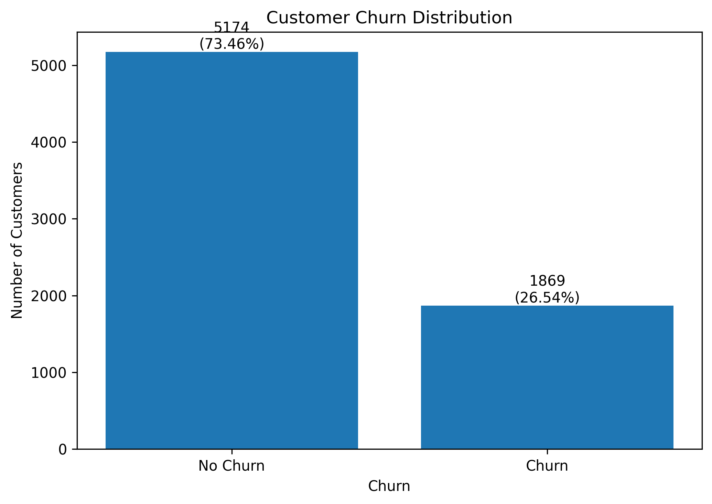
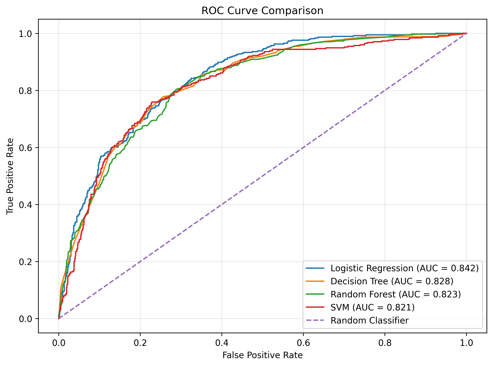
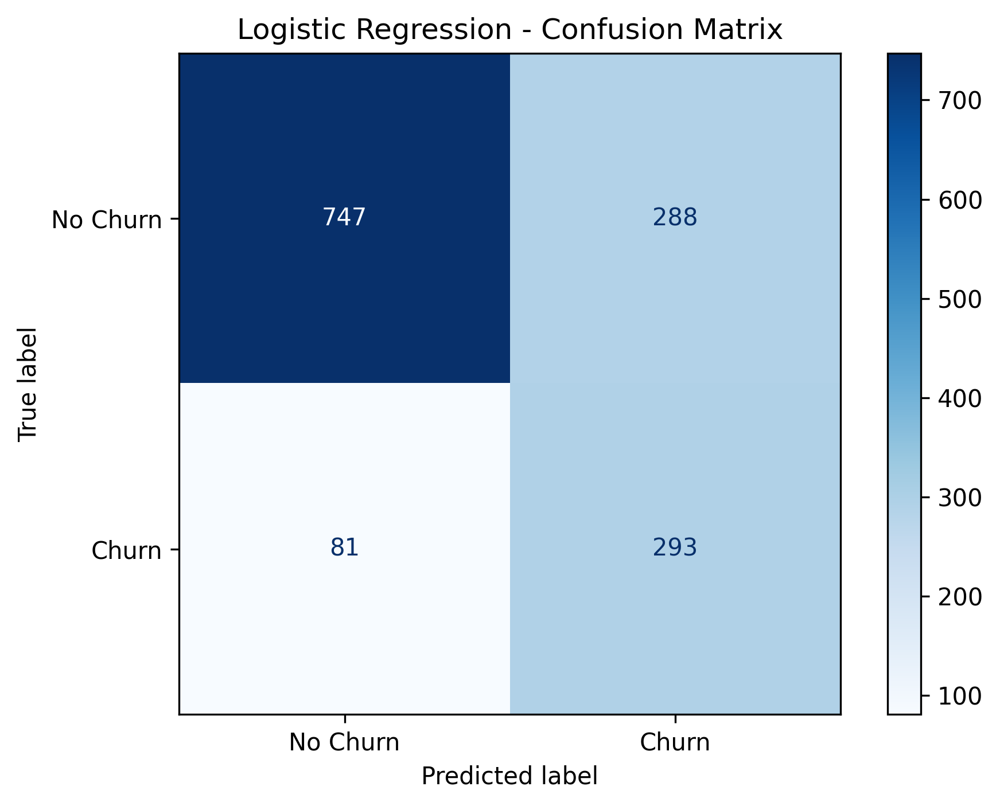
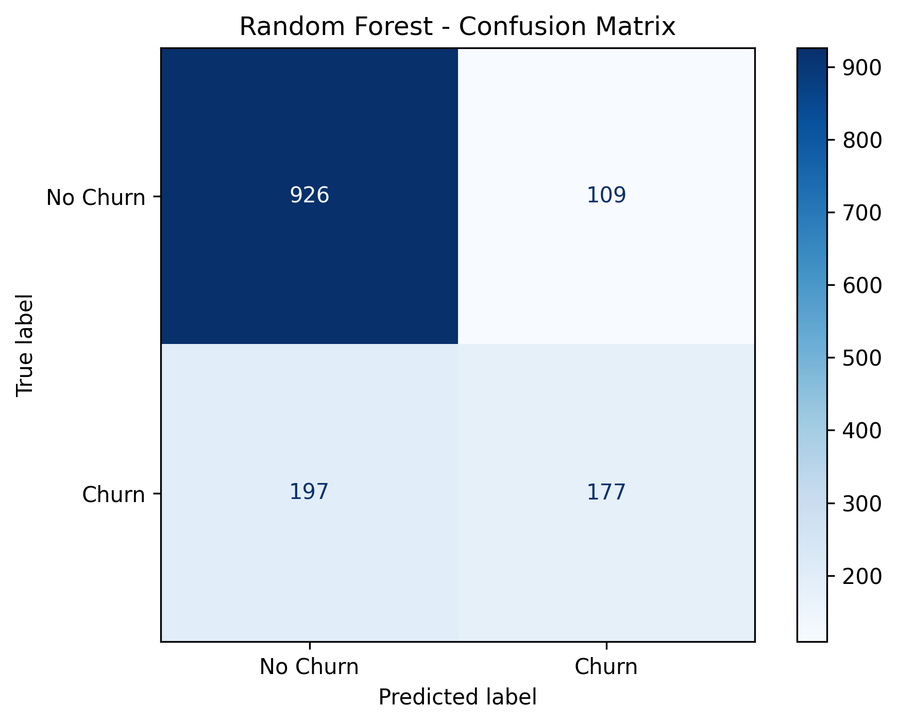
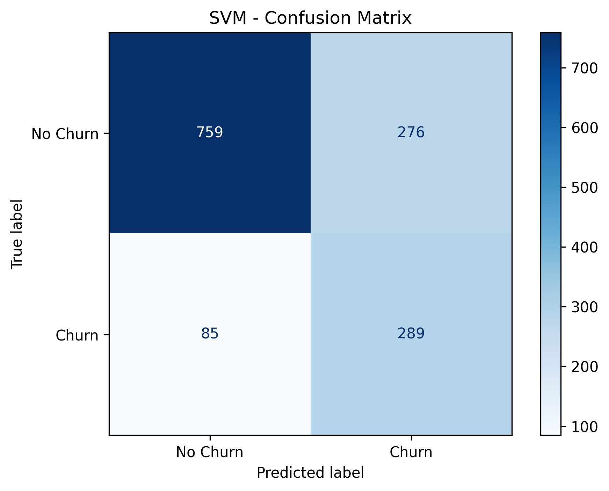

# Telco Customer Churn: Risk Prediction and Customer Profiling

An end-to-end machine learning project that evaluates customer churn risk from telecom customer, service, contract, and billing data. The notebook compares classification models, selects a tuned model using training cross-validation, evaluates it on a held-out test set, and uses predicted probabilities to describe a higher-risk customer segment.

> **Use case:** support customer retention review by prioritising cases for human follow-up. Predictions are not guarantees of churn and do not establish that an intervention will prevent it.

## Project at a glance

- **Task:** supervised binary classification (`Churn`: Yes/No)
- **Dataset:** 7,043 customer records and 21 columns in the raw file
- **Model selection:** highest mean ROC-AUC from stratified five-fold cross-validation on the training set
- **Selected tuned model:** Random Forest
- **Notebook:** [`Group27_Telco_Churn_Notebook.ipynb`](notebooks/Group27_Telco_Churn_Notebook.ipynb)
- **Video demo:** [Watch the project demonstration](https://youtu.be/--Oegdv1soI)

## Results

The repository’s `model_comparison_results.csv` records the initial, untuned comparison. Its Random Forest result had the highest cross-validation accuracy (0.7861), while Logistic Regression had the highest CV ROC-AUC (0.8460). Because the notebook declares ROC-AUC as the selection metric, the initial comparison alone does not select Random Forest.

The notebook then tunes the candidate models and selects Random Forest by its highest mean five-fold training CV ROC-AUC. The notebook reports these tuned results:

| Evaluation | ROC-AUC | Average Precision | Accuracy | Precision | Recall | F1 |
|---|---:|---:|---:|---:|---:|---:|
| Tuned Random Forest, training 5-fold CV | 0.8479 | 0.6628 | — | — | — | — |
| Tuned Random Forest, held-out test set | 0.8431 | 0.6499 | 0.7615 | 0.5348 | 0.7807 | 0.6348 |

The held-out test set contains 1,409 customers. At the estimator’s default classification decision rule, the notebook reports 292 true positives, 82 false negatives, 254 false positives, and 781 true negatives. The holdout Brier score is 0.1579. The higher-risk quartile in the notebook’s descriptive profiling had an observed churn rate of 62.6%, compared with 14.5% in the other 75%; this is a post-selection description, not an operational threshold.

For the initial, untuned results and all recorded metrics, see [`model_comparison_results.csv`](results/model_comparison/model_comparison_results.csv) and [`cross_validation_results.csv`](results/model_comparison/cross_validation_results.csv). Those files are not the tuned model’s final test metrics; the notebook records those separately.

## Workflow

1. Inspect the dataset schema, target distribution, missing values, duplicates, and feature distributions.
2. Convert `TotalCharges` to numeric and treat the 11 blank values as zero; the notebook records that those rows have zero tenure and `Churn = No`.
3. Use stratified train/test splitting and leakage-aware scikit-learn pipelines. Numerical variables are scaled and categorical variables are one-hot encoded within the modeling workflow.
4. Compare a majority-class dummy baseline and Logistic Regression, Decision Tree, Random Forest, and SVM candidates. Evaluate candidates with stratified five-fold cross-validation and tune using ROC-AUC.
5. Evaluate the selected model once on the held-out test set, then inspect its confusion matrix, ranking, calibration, permutation importance, and a descriptive higher-risk quartile.

The dataset has an imbalanced target, so accuracy is presented alongside precision, recall, F1, ROC-AUC, and Average Precision. Associations and feature importance are descriptive, not causal.

## Visual results

### Churn distribution



### ROC curves across candidate models



### Confusion matrices

| Logistic Regression | Decision Tree |
|---|---|
|  |  |

| Random Forest | SVM |
|---|---|
|  |  |

### Other analyses

- [Logistic Regression feature coefficients](results/figures/logistic_regression_feature_coefficients.png)
- [Observed churn rate by high-risk profile](results/figures/high_risk_customer_profile_churn_rate.png)

## Repository contents

```text
data/
  raw/          Source Telco Customer Churn CSV
  processed/    Cleaned dataset and processing notes
documentation/ Analysis logs, data dictionary, and workflow diagram
models/        Model artifact directory
notebooks/     End-to-end analysis notebook
presentation/  Demo script
report/        Final project report
results/
  figures/         Evaluation and analysis figures
  model_comparison/ CSV result tables and customer profile
DEMO.md             YouTube demonstration link
```

Personal learning-journey documents are excluded from the public repository through `.gitignore`.

## Reproducing the analysis

The project’s executable workflow is provided as a Jupyter notebook. The notebook currently uses a Google Colab file-upload cell to load the raw CSV. To reproduce it, open the notebook in Google Colab or a compatible Jupyter environment, provide `data/raw/WA_Fn-UseC_-Telco-Customer-Churn.csv` when prompted, and run the cells from top to bottom.

The notebook imports Python’s standard library and uses NumPy, pandas, Matplotlib, IPython, and scikit-learn. The repository does not include a dependency lockfile or requirements file; compatible package versions must be installed in the notebook environment. No standalone application or command-line entry point is present in the repository.

## Data and documentation

- Raw dataset: [`WA_Fn-UseC_-Telco-Customer-Churn.csv`](data/raw/WA_Fn-UseC_-Telco-Customer-Churn.csv)
- Processed data notes: [`data/processed/README.md`](data/processed/README.md)
- Data dictionary: [`Data_Dictionary.xlsx`](documentation/Data_Dictionary.xlsx)
- Workflow diagram: [`Workflow_Diagram.pdf`](documentation/Workflow_Diagram.pdf)
- Final report: [`Group27_Final_Report.docx`](report/Group27_Final_Report.docx)
- Demo link: [`DEMO.md`](DEMO.md)

## Limitations

The data represents a particular telecom customer population and may not generalise to other providers or later periods. The final evaluation uses one stratified holdout set; future-period or external validation is needed before operational use. The notebook’s higher-risk cutoff is an exploratory quartile definition, and any business threshold would need separate validation against retention capacity and the costs of false positives and missed churners.
